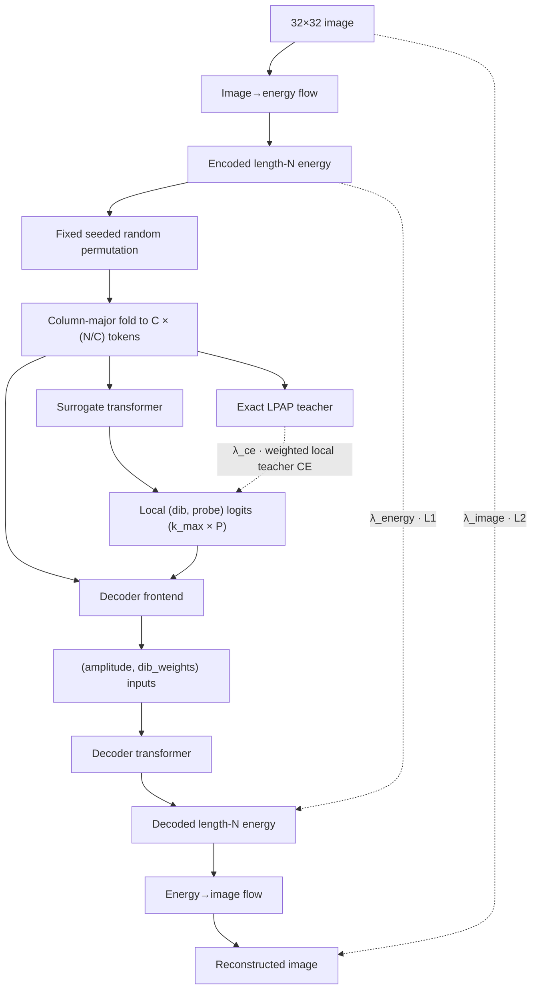

# Linear Probing Amplitude Pooling

See the [documentation index](index.md) for the full documentation map and the [glossary](glossary.md) for short definitions of LPAP terms.

Linear Probing Amplitude Pooling, or LPAP, is a pooling operator for reducing a flat tensor of `N` values into a compact table of `C` buckets, where `N > 0`, `N % C == 0`, and `1 <= k_max <= C`. The maximum roll count `k_max` bounds how far probing advances.

The operator tracks two output table tensors along with explicit occupancy flags:

- `buckets`: `C` pooled values selected by largest absolute amplitude.
- `dibs`: `C` integer distances in `[0, k_max - 1]` from each selected value's initial bucket.
- `bucket_valid`: `C` boolean flags marking whether a bucket holds a real value (initialized `False`).

It also maintains working copies of the folded input (`work`, initialized from `values` without mutating the input), per-slot validity (`work_valid`, initialized `True`), per-slot probe indices (`work_probe`), and per-slot distance offsets (`dibs_diff`, initialized `0`) that reconstruct exact distances when displaced values re-enter the table.

In practice, LPAP runs batched. A single example has input shape `N`, bucket shape `C`, and dib shape `C`; a batched call applies the same operator independently across arbitrary leading batch dimensions:

```text
values:  B x N
buckets: B x C
dibs:    B x C
```

## Why Amplitude And DIB (Inverting The Table)

LPAP is not bare top-`k`. Each kept peak is an **amplitude** plus a **DIB**
(bucket-modulo location). In linear-probing language, the DIB pins the source
only up to a **collision set**: every index compatible with that bucket class
and probe residue. A single `(amplitude, DIB)` is therefore underdetermined for
exact placement on the length-`N` latent.

The design bet is that the **whole table** is enough to invert: given all
buckets' values and collision sets together, attention cross-references peaks
and selects, for each bucket, which member of its collision set is consistent,
then writes a dense energy. Coarse `C` tends to keep the strongest magnitudes
(global sketch); larger `C` adds the next amplitude tiers. Running several `C`
values in parallel creates a path toward a **progressively compressible**
latent. See also the [permutation note](lpap-pseudocode.md#notes-on-the-figure):
a fixed seeded random permutation keeps structured locality from aligning with
the fold lanes.

In the learned stack this splits into three parts:

- **Surrogate** (`LPAPSurrogateTransformer`) emulates LPAP: from column-major
  folded energy `(B, C, P)` it predicts local `(dib, probe)` logits of shape
  `(B, C, k_max * P)`, where class index `c = dib * P + probe` identifies both
  the circularly preceding source lane `(bucket - dib) mod C` and the probe slot
  `probe`.
- **Decoder frontend** (`prepare_lpap_decoder_batch`) gathers the `k_max * P`
  visible candidates for each bucket and applies categorical straight-through
  `p_st = one_hot(argmax(z)) + (p - p.detach())` with `p = softmax(z)`:
  - `amplitudes = (p_st * visible).sum(dim=-1)` selects the hard candidate
    amplitude in the forward pass while routing straight-through gradients to
    the surrogate logits and exact zero-smear gradients to the selected source
    element.
  - `dib_weights = p_st.reshape(B, C, k_max, P).sum(dim=-1)` supplies a
    bit-exact one-hot DIB vector in the forward pass with live marginal DIB
    gradients in the backward pass.
  - Exact-LPAP training and inference use `prepare_exact_lpap_decoder_batch`,
    which feeds exact `(buckets, one_hot(dibs, k_max))` directly from
    `lpap_tokens_torch` or `lpap_tokens_triton`.
- **Decoder** (`LPAPDecoderTransformer`) embeds each bucket's amplitude,
  expected source-bucket identity `(b - d) mod C` via `dib_weights`, DIB
  embedding, and learned bucket position embedding, runs circular-RoPE
  `TransformerBlock` layers (`circular=True`), and predicts `P`-way probe
  logits `(B, C, P)` restricted to the `P`-element collision set `S(b, d)`.
  See [Decoder loss](#decoder-loss).

## Current Model Context

The training stack uses LPAP as the supervised target for the surrogate and as
the recipe for the decoder's compact `(amplitude, dib_weights)` inputs. The
diagram shows the image-autoencoder forward path. Teacher training runs the
same inner LPAP block on length-`N` rows from an empirical i2e energy bank.



Code paths: `lpap_tokens_torch` / `lpap_tokens_triton` (single LPAP operator
source of truth), `prepare_lpap_surrogate_batch`, `lpap_surrogate_targets`,
`prepare_lpap_decoder_batch`, `prepare_exact_lpap_decoder_batch`, and AE loss
assembly.

- Teacher and surrogate consume the same permuted, column-major folded tokens.
  Weighted cross-entropy compares exact LPAP local targets
  `local_class = dib * P + probe` against the surrogate's `k_max * P` local
  logits, weighted by `|bucket|`.
- The decoder transformer consumes `(amplitudes, dib_weights)` and outputs
  `P`-way probe logits scattered strictly onto the `P` valid collision-set
  indices `pi(p * C + ((b - d) mod C))`.
- Surrogate/decoder teacher runs end at decoded energy. Image L2 and `e2i`
  belong to the autoencoder. The bidirectional flow prior at `t=0` is signed
  log-normal (`σ`, `scale`) when training `image_energy_flow`.

The permutation is seeded once on CPU (`randperm(N)` from `permutation_seed`)
and moved to the training device so it is device-stable. Checkpoints record
both `fold_order = "column_major"` and the concrete `permutation` tensor;
surrogate, decoder, and AE loaders read and validate the stored permutation and
fold order on resume.

## Decoder loss

`lpap_decoder_loss` scatters each bucket's amplitude over its `P`-element
collision set weighted by `dib_weights * softmax(probe_logits)`, then adds a
weighted probe cross-entropy masked to buckets whose predicted DIB matches the
oracle DIB (`dib_match`). For bucket `b`, `a_b` is the bucket amplitude,
`ℓ_b` are the `P`-way probe logits, `p_b*` is the oracle probe index, and
`x` is the energy:

```text
ê  = scatter_add_{b,d,p}(dib_weights[b,d] · softmax(ℓ_b)_p · a_b → pi(p·C + (b - d) mod C))
L1 = mean(|ê − x|)
w_b = |a_b|.detach()
m_b = w_b · 1[dib_b == dib_b*]
CE = Σ_b m_b · CE(ℓ_b, p_b*) / Σ_b m_b
λ  = λ_0 · clamp(L1.detach() / L1_ref, 0, 1) ^ p
loss = L1 + λ · CE
```

`w_b` only rescales the CE. It is detached so the CE term trains probe logits
without pulling amplitudes. Teacher TOMLs set `λ_0 = source_ce_weight = 0.1`,
`L1_ref = 0.05`, `p = 2`.

## Surrogate and decoder attention

The surrogate model consumes `C` tokens of dimension `P = N // C`. Its
attention mask is circular-backward: bucket token `i` attends to the rolled
source lanes that LPAP inspects, `(i - roll) mod C` for `roll < k_max`.
Surrogate and decoder blocks attend with `scaled_dot_product_attention`.
The boolean mask uses `True` = may attend, and every LPAP mask keeps the
diagonal.

Both surrogate and decoder blocks (`circular=True`) use periodic circular RoPE.
With `N = C` tokens and rotary pairs `m = 1 .. head_dim // 2`, the frequencies
are `2π m / N`, so a shift of `N` positions is the identity and a circular lane
shift stays equivariant with the ring topology. Cosine and sine tables are
non-persistent buffers, rebuilt on the forward from token count, dtype, and
device; checkpoints do not store them.

## Tensor View (Column-Major Fold)

Given an input tensor `values` with `N` elements (`N > 0`, `N % C == 0`,
`P = N // C`), LPAP folds flat positions in **column-major** order
(`LPAP_FOLD_ORDER = "column_major"`):

```text
tokens[b, p] = values[p * C + b]    for b in 0..C-1, p in 0..P-1
```

Each row `b` is one initial bucket lane of length `P`. Each column `p` is one
probe position across all buckets. `fold_permutation_tokens` and
`unfold_permutation_tokens` implement this bijection (`values.reshape(*batch, P, C).movedim(-1, -2)`),
and `lpap_torch`, `lpap_triton`, `lpap_surrogate_targets`, and
`animations/lpap_operator.py` all share it.

## Projection Step

At each roll step `k = 0 .. k_max - 1`, bucket `i` inspects source lane
`lane = (i - k) mod C`:

1. Mask out slots where `work_valid` is `False` or `work` is `NaN`.
2. Select `j = argmax_p |work[lane, p]|` among valid finite slots.
3. Compute `candidate = work[lane, j]` and `candidate_dib = k + dibs_diff[lane, j]`.
4. Accept when `has_valid_candidate` and either `not bucket_valid[i]` or
   `|candidate| >= |buckets[i]|`.

## Collision And Swap-Back

Buckets begin empty (`bucket_valid = False`). Empty buckets accept any valid
finite candidate (including a real `0.0` in the input) and write `work_valid = False`
back into the vacated candidate slot rather than swapping a phantom zero back
into `work`.

When an occupied bucket (`bucket_valid = True`) is displaced by a candidate
with `|candidate| >= |buckets[i]|`, the previous bucket entry swaps back into
`work[lane, j]` with:

- `work[lane, j] = old_bucket`
- `work_valid[lane, j] = True`
- `dibs_diff[lane, j] = old_dib - k`
- `work_probe[lane, j] = old_probe`

If that displaced value re-enters another bucket on a later roll `k' > k`, its
reconstructed DIB is `k' + (old_dib - k)`, which equals its exact distance from
its original lane. Because `1 <= k_max <= C`, every valid DIB lies in
`[0, k_max - 1]`.

## High-Level Algorithm

```text
input: values with N elements, bucket count C, maximum roll count k_max
require: N > 0, N % C == 0, 1 <= k_max <= C

P = N // C
work = column_major_fold(values, C, P)    # copy; input values is untouched
work_valid = ones(C, P, dtype=bool)
work_probe = broadcast(0..P-1, (C, P))
dibs_diff = zeros(C, P, dtype=int64)
buckets = zeros(C)
dibs = zeros(C, dtype=int64)
bucket_probes = zeros(C, dtype=int64)
bucket_valid = zeros(C, dtype=bool)

for k in 0 .. k_max - 1:
    lane_i = (i - k) mod C                # for each bucket i in 0..C-1
    valid_lane = work_valid[lane_i] & ~isnan(work[lane_i])
    scores = where(valid_lane, abs(work[lane_i]), -1.0)
    j_i = argmax(scores, dim=-1)
    has_cand_i = scores[j_i] >= 0.0
    cand_i = work[lane_i, j_i]
    cand_dib_i = k + dibs_diff[lane_i, j_i]
    cand_probe_i = work_probe[lane_i, j_i]

    take_i = has_cand_i & (~bucket_valid[i] | (abs(cand_i) >= abs(buckets[i])))
    where take_i:
        work[lane_i, j_i] = where(bucket_valid[i], buckets[i], 0.0)
        work_valid[lane_i, j_i] = bucket_valid[i]
        dibs_diff[lane_i, j_i] = where(bucket_valid[i], dibs[i] - k, 0)
        work_probe[lane_i, j_i] = where(bucket_valid[i], bucket_probes[i], j_i)
        buckets[i] = cand_i
        dibs[i] = cand_dib_i
        bucket_probes[i] = cand_probe_i
        bucket_valid[i] = True

remaining = column_major_unfold(where(work_valid, work, 0.0))
output: buckets, dibs, bucket_probes, remaining
```

## Implementation Notes

- Amplitude comparison uses `abs(value)` while preserving the signed value in `buckets` and `remaining`.
- The PyTorch reference (`lpap_tokens_torch`) uses fixed-shape `torch.roll`, `torch.gather`, and `torch.where` with zero boolean-mask CPU-GPU syncs and full autograd support.
- The Triton implementation (`lpap_tokens_triton` / `lpap_triton`) runs the same column-major algorithm on CUDA with dynamic loops, `int64` offsets, typed stores, `NaN`/`B == 0` guards, and raises `RuntimeError` if `requires_grad` is set. `triton` is imported lazily so CPU-only environments work without `triton`.
- Global source indices are recovered deterministically from `(dibs, bucket_probes)` and `permutation`: `flat_perm_pos = bucket_probes * C + (bucket_index - dibs) % C`, then `source_index = permutation[flat_perm_pos]`.
