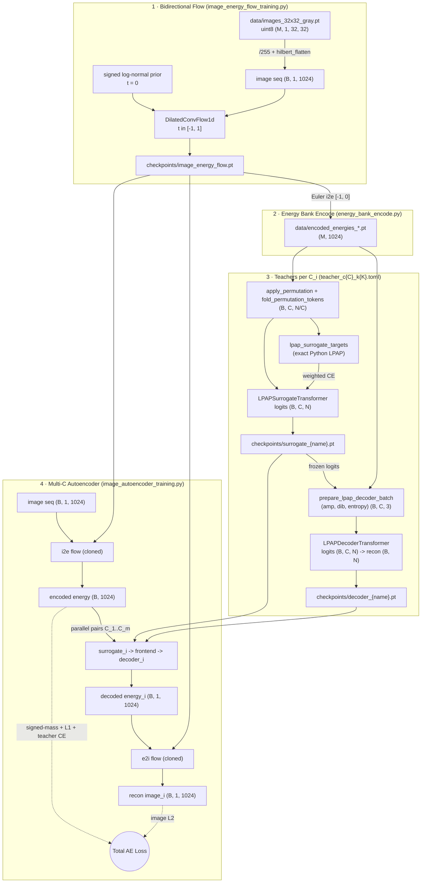

# LPAP Code Review — STEP 1 of 3

Scope: (a) repository architecture map and (b) correctness audit of the LPAP operator and its direct interfaces (`ops.py`, `triton_ops.py`, `permutation.py`, `surrogate.py`, `decoder.py`), with an eye toward extending the codebase to LPAP bottlenecks on frozen LLM hidden states / embeddings (`(B, T, D)` tensors, small residual/flow AE, multiple `C` branches, next-token KL objective).

No existing source files are modified in this step. New artifacts on this branch: this report (`docs/review/STEP1.md`) and `test/test_lpap_review_step1.py`.

---

## (a) Architecture Map

### 1. Repository Layout & Modules

| Area | Files | Role |
| --- | --- | --- |
| **Core LPAP operator** | `src/lpap/ops.py`, `src/lpap/triton_ops.py`, `src/lpap/permutation.py` | Reference PyTorch LPAP (`lpap_torch`), CUDA Triton kernel (`lpap_triton`), CPU-seeded permutation + fold/unfold helpers. |
| **Learned LPAP bottleneck** | `src/lpap/transformer.py`, `src/lpap/surrogate.py`, `src/lpap/decoder.py` | RoPE `TransformerBlock`, `LPAPSurrogateTransformer` + duplicated Python LPAP target builder (`lpap_surrogate_targets`), decoder frontend (`prepare_lpap_decoder_batch`) + `LPAPDecoderTransformer`. |
| **Image & flow domain** | `src/lpap/hilbert.py`, `src/lpap/data.py`, `src/lpap/flow.py` | 2D Hilbert curve flatten/unflatten (`32x32 -> 1024`), uint8 `ImageTensorDataset` + `float_image_batch`, 1D dilated Conv1d flow (`DilatedConvFlow1d`) + bidirectional flow matching + Euler midpoint integrator. |
| **Empirical energy bank** | `src/lpap/energy_bank.py`, `src/lpap/energy_bank_encode.py` | Offline `(n, energy_dim)` energy bank storage/validation/epoch cycling and i2e flow encoder with scale guards. |
| **Training stacks** | `src/lpap/flow_training.py`, `src/lpap/image_energy_flow_training.py`, `src/lpap/surrogate_training.py`, `src/lpap/decoder_training.py`, `src/lpap/image_autoencoder_training.py`, `src/lpap/image_autoencoder_loss.py` | Config dataclasses, session builders, train/val loops, gallery collectors, signed-mass balance loss and lambda-dial CLI (`ae-loss-probe`). |
| **Config & checkpoint orchestration** | `src/lpap/training.py`, `src/lpap/checkpoints.py`, `src/lpap/training_log.py`, `src/lpap/teacher_config.py`, `src/lpap/teacher_checkpoints.py`, `src/lpap/training_notebook.py` | `TrainingRun` (resume, best tracking, cadence checkpoint/SQLite logging, optional HF upload & Pushover notify), atomic `.pt` checkpoints with JSON-encoded `training_state` (tensors serialized as JSON lists), SQLite run/attempt/metric store, shared teacher pair TOML projection, model-kind dispatcher. |
| **Storage, sync, notify, status, viz** | `src/lpap/storage.py`, `src/lpap/artifact_sync.py`, `src/lpap/dataset_fetch.py`, `src/lpap/notify.py`, `src/lpap/training_status.py`, `src/lpap/training_plots.py`, `src/lpap/visualization_notebook.py` | `configs/storage.toml` loader, dual-slot HF bucket checkpoint sync (`slot0`/`slot1` + `current.json`), zstd image archive fetch, Pushover client, status CLI, pure-Python PNG/SVG gallery renderers. |
| **One-off migration CLIs** | `src/lpap/migrate_teacher_permutations.py`, `src/lpap/migrate_ae_permutations.py` | Salvage CLIs to rewrite stored permutation tensors in teacher and AE checkpoints. |
| **Molab remote GPU layer** | `molab/bg_worker.py`, `molab/jobs.py`, `molab/lab.py`, `.github/skills/molab-workflow/scripts/*` | Detached background training launchers (generate standalone Python scripts under `training_logs/`), marimo status/gallery notebook, bash wrappers over `marimo-pair`. |
| **Bench, docs, animations, tests** | `bench/bench_lpap.py`, `animations/lpap_operator.py`, `doc/*`, `test/*` | PyTorch vs Triton benchmark, Manim walkthrough, TeX algorithm/loss frames, 171 existing CPU-runnable unit tests + 3 CUDA-gated tests. |

### 2. Data Flow & Training Pipeline

### 3. Entry Points & Configs

- **Pixi tasks (`pixi.toml`)**: `test` (`unittest discover`), `lint` / `format` (`ruff`), `bench-lpap`, `ae-loss-probe`, `train-status`, `data-download`, `artifacts-download` / `artifacts-upload`, `migrate-teacher-permutations`, `migrate-ae-permutations`, `notebook-lab`, `manim-*`, `tex-*`.
- **Module CLIs**: `python -m lpap.artifact_sync`, `lpap.dataset_fetch`, `lpap.training_status`, `lpap.image_autoencoder_loss`, `lpap.migrate_teacher_permutations`, `lpap.migrate_ae_permutations`, `molab.jobs` (`launch-image-energy-flow`, `launch-lpap-teacher`, `launch-ae-bidirectional-flow`).
- **Configs**:
  - `configs/storage.toml`: HF bucket IDs (`artifacts.bucket`, `images.bucket`) and archive paths (required under project root).
  - `configs/training/image_energy_flow.toml`, `image_autoencoder.toml`, `teacher_c{128_k16,256_k24,512_k32}.toml`: live operator configs.
  - `test/resources/training/*.toml`: frozen contract fixtures for unit tests.
  - `configs/secrets.toml.example`: gitignored `HF_TOKEN` and Pushover template.
- **Note on config drift**: `configs/training/image_autoencoder.toml` defines a single legacy pair (`surrogate_c128_k4.pt` / `decoder_c128_k4.pt`), whereas `molab/jobs.py:218-272` and `molab/lab.py:275-318` hardcode the tri-pair AE config (`c128_k16`, `c256_k24`, `c512_k32`) in Python instead of loading `image_autoencoder.toml`.

### 4. Environment & Dependencies

- **Pixi (`pixi.toml`)**: `linux-64`, Python `3.14.x`, `[system-requirements] cuda = "12.0"`, conda-forge `pytorch-gpu >=2.10`, `triton >=3.6`, `jaxtyping`, `ruff`, `cuda-*`, `marimo`, `zstandard`, `manim`, `tectonic`, `poppler`; PyPI `huggingface-hub >=1.21`.
- **CI (`.github/workflows/test.yml`)**: Sets `CONDA_OVERRIDE_CUDA="12.0"` on CPU runners so `pixi install` solves the GPU lockfile; runs `pixi run lint` and `pixi run test`.
- **`pyproject.toml`**: Lists only `jaxtyping>=0.3.7` and `torch>=2.10` (omits `triton`, `zstandard`, `huggingface-hub`), even though `src/lpap/__init__.py:115` eagerly imports `lpap.triton_ops` (which unconditionally executes `import triton`). On any CPU-only or non-Linux environment without `triton`, `import lpap` fails immediately.
- **Public package import surface (`src/lpap/__init__.py`)**: Core modules are imported eagerly; heavy training/notebook/plot modules use PEP 562 lazy `__getattr__`.

### 5. Structural Gaps Relevant to the LLM Hidden-State Goal

- **2-D batch assumption**: `lpap_torch` and `permutation.py` accept arbitrary leading dims `(*batch, N)`, while `prepare_lpap_surrogate_batch`, `lpap_surrogate_targets`, `LPAPSurrogateTransformer`, `prepare_lpap_decoder_batch`, and `LPAPDecoderTransformer` enforce 2-D `(B, N)` / 3-D `(B, C, *)`. LLM token sequences `(B, T, D)` must either flatten `(B*T, D)` at the boundary or generalize leading batch dims across surrogate/decoder APIs.
- **Image/Hilbert coupling in AE**: `image_autoencoder_training.py` couples the multi-`C` parallel LPAP bottleneck (`ImageAutoencoderModel`) tightly to `DilatedConvFlow1d`, `hilbert_unflatten_images`, and Euler rollout steps. Extracting a domain-agnostic multi-`C` LPAP bottleneck module is straightforward once the operator/frontend bugs below are resolved.
- **Performance bottleneck on GPU**: Both `lpap_torch` and `lpap_surrogate_targets` perform boolean-mask indexing inside the `for roll_count in range(k_max)` loop, triggering CPU-GPU synchronizations on every roll step, and `lpap_triton` is unused and unsuitable for large `(C, K)` as written (see Findings 3, 6, 8).

---

## (b) LPAP Operator Correctness Audit

### Spec vs Implementation Summary

| Spec requirement (`README.md`, `doc/lpap.md`, `doc/lpap-pseudocode.md`) | Implementation status |
| --- | --- |
| Fixed seeded random permutation as hash | Implemented in `permutation.py` (CPU-seeded `randperm(N)`, device-stable). Not integrated into `ops.py`; `as_long_permutation` / `invert_permutation_indices` do not validate bijectivity. |
| Fold `N` into `C x (N/C)` lanes | **Divergent**: `ops.py` & `triton_ops.py` use row-major `(C, P)` matching `doc/lpap.md`; `permutation.py` & `surrogate.py` use column-major `(P, C).T`. |
| Top-`C` by `abs(value)` with linear probing & `K` roll budget | Matches on distinct finite non-zero inputs (`K = C` recovers exact top-`C`; `K < C` stops cleanly leaving unplaced peaks in `remaining`). Fails invariants on zeros, ties, `NaN`, and `N = 0`. |
| DIB recording (`k + dibs_diff`, swap-back `old_dib - k`) | Exact for real non-zero values when `0 <= k < C`. **Broken in `decoder_dibs_from_source_logits`** (ignores `permutation`); polluted by phantom initial zeros and `>=` tie-churn (`dib >= C` when `K > C`, `dib > 0` when `C = 1` or `C = N`). |
| In-place modification of input tensor | **Spec mismatch**: `doc/lpap.md:155,224` states input is modified in place; `ops.py:41` and `triton_ops.py:116` clone/copy and `test/test_lpap.py:20` asserts input is unchanged. |

### Edge-Case Matrix

| Edge case | Observed behavior | Verdict |
| --- | --- | --- |
| **`K` exhausted (`K < C`)** | Stops at `k_max`; unplaced peaks remain in residual; `0 <= dib < k_max` on distinct finite values. | Pass |
| **`K >= C` (distinct finite values)** | `K = C` recovers exact top-`C` with `0 <= dib < C`; extra rolls `k >= C` are no-ops. | Pass |
| **Ties (`|a| == |b|`)** | `>=` gate swaps equal-amplitude values, increasing DIB unnecessarily; for `K > C` or `C = 1`, pushes `dib >= C`. | **Bug** (Finding 2) |
| **`C == N` (`P == 1`)** | Non-zero values keep `dib = 0`; any `0.0` entry swaps with phantom zeros for `K > 1`, yielding `dib > 0`. | **Bug** (Finding 2) |
| **`C > N` (`N > 0`)** | Rejected with `ValueError` (`N % C != 0`). | Pass |
| **`N == 0` (empty last dim)** | Passes `0 % C == 0`; `lpap_torch` crashes with `IndexError` in `argmax`; `lpap_triton` does OOB GPU read/write. | **Bug** (Finding 5) |
| **`C == 1`** | Distinct values keep `dib = 0`; tied max amplitudes yield `dib = 1` for `K > 1`. | **Bug** (Finding 2) |
| **Zero / sparse inputs** | Phantom initial zeros swapped into `work` at `k = 0` get picked at `k >= 1`, producing duplicate/wrong `source_indices` (`values[source_indices] != buckets`) and zeroing autograd gradients on all-zero inputs. | **Bug** (Finding 2) |
| **Negative / signed values** | Selects by `abs()`, preserves original signs. | Pass |
| **`NaN` / `Inf`** | `Inf` selects `±inf` (ties swap on `>=`). `NaN` in `lpap_torch` wins `argmax` then fails `>=`, masking all finite values in that lane; in `lpap_triton`, `NaN` causes OOB GPU memory access. | **Bug** (Findings 4, 7) |
| **Batch dims (`1D`, `3D`, `4D`, `B = 0`)** | `lpap_torch` supports arbitrary `(*batch, N)` and `B = 0`. `lpap_triton` launches an empty `(0,)` grid for `B = 0`. Surrogate/decoder APIs restrict inputs to 2-D `(B, N)`. | Partial (Findings 6, 11) |
| **Dtype / contiguity / device** | `lpap_torch` handles `fp16`/`bf16`/`fp32`/`fp64`, non-contiguous tensors, rejects integer dtypes. `lpap_triton` stores untyped Python `0`/`0.0` scalars to `*i64`/non-`fp32` pointers and detaches autograd on CUDA. | Partial (Finding 6) |
| **Gradient flow / surrogate** | `lpap_torch` routes exact gradients through `buckets` & `remaining` across multi-hop swap-backs (fails on all-zero `K > 1` due to phantom zeros). `lpap_triton` silently detaches on CUDA. Decoder frontend flows grads through `amplitudes` & `entropy`; `dibs` uses hard `argmax`. | Partial (Findings 2, 6, 12) |
| **Determinism** | Bit-exact under `torch.use_deterministic_algorithms(True)` for `lpap_torch`, `make_permutation_indices`, and `lpap_surrogate_targets`. | Pass |

---

### Ranked Findings

#### Critical

1. **`decoder_dibs_from_source_logits` ignores `permutation`, corrupting decoder DIB tokens**
   - **Location**: `src/lpap/decoder.py:52-66`, called at `src/lpap/decoder.py:113`
   - **What**: `surrogate_logits` predicts unpermuted source indices `idx = P[pos]` (`surrogate.py:115-118`, `decoder.py:112`). `decoder_dibs_from_source_logits` computes `source_buckets = source_indices % bucket_count` directly on `idx` without applying `P^{-1}`.
   - **Why**: For any non-identity permutation (every real training config), `P[pos] % C != pos % C`. Even with a 100% oracle surrogate, `prepare_lpap_decoder_batch(...).dibs` does not match `targets.dibs` (verified: oracle returns `[3, 0, 3, 2]` vs true `[0, 0, 0, 0]`). The decoder receives `(i - (idx % C)) % C` in `[0, C-1]` (an unpermuted stride-`C` comb) instead of true LPAP DIBs in `[0, k_max-1]`, breaking the exact-LPAP equivalence contract (`doc/lpap.md:46-52`) and making exact LPAP `(a, d)` unusable as a drop-in decoder input at inference time.
   - **Suggested fix**: Pass `permutation` into `decoder_dibs_from_source_logits`; when provided, map `permuted_positions = invert_permutation_indices(permutation.to(logits.device))[source_indices]` before `% bucket_count`. Revisit the DIB normalizer (`decoder.py:114`: `max(bucket_count - 1, 1)` compresses true DIBs into `[0, (k_max - 1)/(C - 1)]`).

2. **Phantom initial zeros + `>=` gate corrupt `source_indices`, DIBs, and zero-input gradients**
   - **Location**: `src/lpap/surrogate.py:50-106`, `src/lpap/ops.py:47-88`, `src/lpap/triton_ops.py:48-79`, `src/lpap/decoder.py:127, 232-240`
   - **What**: `buckets` is initialized to `0.0` (with `dibs = 0`, `bucket_indices = 0`) and swaps whenever `abs(candidate) >= abs(bucket)`. At `k = 0`, every bucket swaps its synthetic initial `0.0` (carrying `bucket_indices = 0`) into `work`.
   - **Why**:
     - **Duplicate/false `source_indices`**: On sparse inputs (e.g., `[10, 0, ..., 0]`, or ReLU/zero-padded LLM activations), at `k >= 1` `argmax` picks the phantom zero carrying `work_indices = 0`, assigning another bucket the exact `source_index` of `10.0`. `values.gather(1, targets.source_indices)` returns `[10, 0, 10, 0]` instead of `[10, 0, 0, 0]`. In `lpap_decoder_loss`, because `batch.weights = amplitudes.abs()` (soft surrogate expectation, typically `> 0`), `source_ce` actively trains the decoder toward that duplicated index.
     - **Invalid DIBs on edge cases**: Produces `dib > 0` when `C == N` (`P == 1`, zero collisions), `dib == 1` when `C == 1` with ties (`[5, -5]`), and `dib >= C` when `K > C` with ties (exceeding the `[0, C-1]` decoder range). Equal-amplitude ties at `k >= 1` also evict lower-DIB peaks for higher-DIB ties with zero amplitude gain.
     - **Zeroed autograd gradients**: On all-zero inputs with `k_max >= 2`, `buckets` holds phantom constants at `k = 1`, so `buckets.sum().backward()` produces `values.grad == 0`.
   - **Suggested fix**: Track an explicit occupied/valid mask (or initialize empty buckets with sentinel `-inf` amplitude and mark vacated `work` slots invalid with `-inf` score), never swapping uninitialized sentinels back into `work`, and use strict `>` (`abs(candidate) > abs(bucket)`) for already-occupied buckets. Note: this changes tie/zero semantics relative to current `doc/lpap.md:155`; update the spec accordingly.

#### High

3. **Row-major vs column-major fold mismatch between `ops.py`/`triton_ops.py` and `permutation.py`/`surrogate.py`, plus duplicated LPAP loop**
   - **Location**: `src/lpap/ops.py:41`, `src/lpap/triton_ops.py:44` vs `src/lpap/permutation.py:78-89`, `src/lpap/surrogate.py:109`
   - **What**: `lpap_torch` and `lpap_triton` fold flat `(..., N)` as row-major `(C, P)` (`lane = pos // P`), matching `doc/lpap.md:130-137`. `fold_permutation_tokens` and `lpap_surrogate_targets` fold as column-major `(P, C).T` (`lane = pos % C`), matching `animations/lpap_operator.py:45-47`. Meanwhile `surrogate.py:38-127` duplicates the entire LPAP loop instead of calling `ops.py`/`triton_ops.py`, leaving `lpap_torch` and `lpap_triton` unused across the training stack.
   - **Why**: Calling `lpap_torch(values, C, K)` and `lpap_surrogate_targets(prepare_lpap_surrogate_batch(values, C), K)` on the same flat `(B, N)` tensor produces completely different buckets and DIBs. Any future consolidation that swaps `lpap_surrogate_targets` onto `lpap_torch`/`lpap_triton` will silently break trained checkpoints unless both use one canonical fold convention.
   - **Suggested fix**: Pick one canonical fold layout (column-major `pos = p * C + b` matches existing checkpoints, `fold_permutation_tokens`, and `source_buckets = pos % C`; or row-major `pos = b * P + p` matching `doc/lpap.md`), unify `ops.py` / `triton_ops.py` / `surrogate.py` onto a single core operator that optionally returns `source_positions`, and align `doc/lpap.md`.

4. **Out-of-bounds GPU memory access on `NaN` in `_lpap_kernel` (static inspection)**
   - **Location**: `src/lpap/triton_ops.py:58-64`
   - **What**: `_lpap_kernel` computes `index_candidates = tl.where((scores == max_score) & probe_mask, probe_offsets, block_probe_count)` and `candidate_index = tl.min(index_candidates, axis=0)`, then unconditionally loads/stores `work_ptr + source_base + candidate_index`.
   - **Why**: If `max_score` is `NaN` (any all-`NaN` lane, or any single `NaN` if `tl.max` propagates `NaN`), `scores == max_score` is `False` everywhere, so `candidate_index == block_probe_count >= probe_count`, causing out-of-bounds GPU reads and writes (corrupting adjacent lanes/batch items or crashing with illegal memory access).
   - **Suggested fix**: Guard `candidate_index` (e.g., clamp or mask loads/stores with `candidate_index < probe_count` and suppress `should_write` when invalid) and define consistent `NaN` handling across PyTorch and Triton.

5. **Empty value dimension (`N == 0`) passes validation, crashes `lpap_torch`, and causes OOB GPU access in `lpap_triton`**
   - **Location**: `src/lpap/ops.py:16-19`, `src/lpap/triton_ops.py:100-112`, `src/lpap/permutation.py:85`
   - **What**: `values.shape[-1] % bucket_count != 0` evaluates `0 % C == 0` as valid.
   - **Why**: `lpap_torch` crashes inside the loop with `IndexError: argmax(): Expected reduction dim 2 to have non-zero size`. `lpap_triton` computes `_next_power_of_2(0) == 2`, evaluates `probe_mask` as all `False`, gets `candidate_index == 2`, and performs OOB GPU memory access.
   - **Suggested fix**: Require `values.shape[-1] > 0` (i.e., `probe_count > 0`) in `_validate_lpap_args`, `lpap_triton`, `fold_permutation_tokens`, and `lpap_surrogate_targets`.

6. **Triton kernel scalability, autograd parity, `int32` offset overflow, empty batch, and scalar store dtypes (static inspection)**
   - **Location**: `src/lpap/triton_ops.py:37-79, 82-143`
   - **What**:
     1. Nested `tl.static_range(0, k_max)` × `tl.static_range(0, bucket_count)` (`triton_ops.py:43, 51-52`) statically unrolls `C + K * C` bodies (16,896 iterations for `C=512, K=32`), exploding compile time and IR size.
     2. `lpap_triton` has no `torch.autograd.Function` wrapper: on CPU it delegates to `lpap_torch` (`requires_grad=True`), whereas on CUDA it silently returns detached tensors (`requires_grad=False`).
     3. `batch_index = tl.program_id(0)` is `int32`; `batch_index * value_count` overflows at `2^31` elements (reachable with LLM `(B, T, D)` batches).
     4. `batch_count == 0` launches `_lpap_kernel[(0,)]` instead of short-circuiting.
     5. `tl.store` writes Python `0` (`i32`) to `*i64` (`diff_ptr`/`dibs_ptr`) and `0.0` (`f32`) to `*f16`/`*bf16`/`*f64` (`buckets_ptr`) without explicit dtype casts.
   - **Suggested fix**: Use dynamic `range` (or parallelize over buckets in shared memory / registers), cast `tl.program_id(0).to(tl.int64)`, short-circuit `batch_count == 0`, cast store literals explicitly, and either reject `requires_grad=True` or wrap with a custom backward routing gradient.

#### Medium

7. **`NaN` in a lane silently hides all finite elements in `lpap_torch`**
   - **Location**: `src/lpap/ops.py:68-76`, `src/lpap/surrogate.py:77-88`
   - **What**: `argmax` selects `NaN`, then `abs(NaN) >= abs(bucket)` is `False`, so the `NaN` stays in `work` and blocks every finite element in that lane on every roll.
   - **Why**: Unlike standard `NaN` propagation (which surfaces numerical divergence immediately), a single `NaN` silently drops valid activations while leaving `buckets` finite.
   - **Suggested fix**: Either propagate `NaN` explicitly (raise or let `NaN` win) or mask `NaN` scores to `-inf` so finite elements remain selectable; keep PyTorch and Triton identical.

8. **Boolean mask indexing in `lpap_torch` and `lpap_surrogate_targets` forces per-roll CPU-GPU syncs**
   - **Location**: `src/lpap/ops.py:81-88`, `src/lpap/surrogate.py:95-106`
   - **What**: `work[batch_grid[update], source_lane_grid[update], candidate_positions[update]] = ...` indexes with boolean tensor `update` inside `for roll_count in range(k_max)`.
   - **Why**: On CUDA, boolean indexing calls `aten::nonzero`, stalling the GPU with host-device synchronization on every roll step (`k_max = 16..32` × 3 pairs in tri-pair AE) and blocking `torch.compile` full-graph capture.
   - **Suggested fix**: Because `source_lanes` is a bijection per roll, use fixed-shape indexing with `torch.where(update, ...)` (zero host-device syncs, `torch.compile`-friendly).

9. **Non-bijective permutations accepted silently; `invert_permutation_indices` exposes uninitialized memory**
   - **Location**: `src/lpap/permutation.py:31-58`
   - **What**: `as_long_permutation` checks only `ndim == 1` and `numel() == value_count`. `invert_permutation_indices` allocates `torch.empty_like(permutation)` and scatters into `inverse[permutation]`.
   - **Why**: A corrupted checkpoint or bad caller tensor (e.g., `[0, 0, 0, 0]`) passes validation and leaves uninitialized garbage values in `inverse`.
   - **Suggested fix**: Validate `permutation.min() >= 0`, `permutation.max() < n`, and uniqueness (e.g., `torch.equal(permutation.sort().values, torch.arange(n, device=permutation.device))` or boolean seen mask).

10. **Eager `import triton` at package import time breaks CPU-only / non-Linux imports**
    - **Location**: `src/lpap/__init__.py:115`, `src/lpap/triton_ops.py:13-14`, `pyproject.toml:9-12`
    - **What**: `import lpap` eagerly imports `lpap.triton_ops`, which unconditionally imports `triton`, even though `triton` is omitted from `pyproject.toml` dependencies and `lpap_triton` falls back to `lpap_torch` on CPU.
    - **Why**: Prevents importing `lpap` on macOS, Windows, or lightweight CPU environments (and forces `CONDA_OVERRIDE_CUDA="12.0"` in CI).
    - **Suggested fix**: Move `lpap_triton` to `_LAZY_MODULE_EXPORTS` in `src/lpap/__init__.py` and guard `import triton` inside `triton_ops.py` (falling back to `lpap_torch` when CUDA or Triton is unavailable).

11. **Missing input validations in `decoder.py`**
    - **Location**: `src/lpap/decoder.py:52-66` and `src/lpap/decoder.py:81-93`
    - **What**:
      - `prepare_lpap_decoder_batch` validates `temperature > 0` for `int | float`, but skips validation when `temperature` is a `torch.Tensor` (allowing negative or zero temperature -> inverted softmax or `NaN`).
      - `decoder_dibs_from_source_logits` does not check `logits.shape[1] == bucket_count`, raising a raw broadcasting `RuntimeError` instead of `ValueError`.
    - **Suggested fix**: Validate `(temperature_tensor > 0).all()` (or clamp/assert positive scalar tensor) and check `logits.shape[1] != bucket_count -> ValueError`.

#### Low

12. **Redundant exact-LPAP recomputation & surrogate-to-encoder gradient coupling in AE forward**
    - **Location**: `src/lpap/image_autoencoder_training.py:492-503`, `src/lpap/decoder.py:95-106`
    - **What**: `ImageAutoencoderModel.forward_chain` calls `prepare_lpap_surrogate_batch`, runs `surrogate`, and then calls `prepare_lpap_decoder_batch`, which calls `prepare_lpap_surrogate_batch` and `lpap_surrogate_targets` again (even at inference when targets are not needed). Also, `surrogate_tokens` is not detached in `forward_chain`, so `surrogate_teacher_ce` backpropagates into `encoded_energy` (`image_to_energy_flow`).
    - **Why**: Unnecessary compute during training/inference; unclear whether encoder gradients from `surrogate_teacher_ce` are intentional (they reward making `encoded_energy` easier for the surrogate to classify).
    - **Suggested fix**: Allow passing precomputed `tokens` / optional `compute_targets: bool = True` to `prepare_lpap_decoder_batch`, and make gradient flow from `surrogate_teacher_ce` to `encoded_energy` an explicit config choice.

13. **Linear RoPE vs circular attention mask in `LPAPSurrogateTransformer`, plus unmasked unreachable output classes**
    - **Location**: `src/lpap/surrogate.py:130-205`, `src/lpap/transformer.py:54-73`
    - **What**: `LPAPSurrogateTransformer` applies a circular backward mask `(q - k) % C < k_max`, while `RotarySelfAttention` applies linear RoPE positions `0..C-1` (breaking wrap-around shift equivariance between bucket `0` and bucket `C-1`) and mutates non-persistent `_rope_cosines`/`_rope_sines` buffers in `forward`. The output head predicts all `N` classes without masking the `N - min(k_max, C) * P` unreachable source indices per bucket.
    - **Why**: Suboptimal inductive bias for surrogate accuracy and wasted softmax/CE capacity as `N` grows for LLM hidden dimensions (`D = 2048..4096`).
    - **Suggested fix**: Consider masking unreachable source indices in surrogate logits (or predicting relative `(roll, probe)` logits of size `k_max * P` instead of full `N` — also makes the surrogate invariant to `permutation`!), and evaluate circular/relative positional bias.

14. **Documentation / code mismatch on in-place mutation**
    - **Location**: `doc/lpap.md:155, 224`, `doc/lpap-pseudocode.md:23, 38` vs `src/lpap/ops.py:41`, `test/test_lpap.py:20`
    - **What**: Docs say `values` is modified in place; code clones `values` and `test/test_lpap.py:20` asserts `values` is unchanged.
    - **Suggested fix**: Update docs to specify that LPAP operates on an internal working copy and returns the residual tensor without mutating `values`.

---

## Tests Added & Results

Added `test/test_lpap_review_step1.py` (21 tests: 13 `@unittest.expectedFailure` bug proofs + 8 passing edge-case verifications).

Executed on CPU (`Python 3.14.10`, `torch 2.15.0+cpu`, `triton 3.9.0`, `ruff 0.17.6`):

- `ruff check src/lpap molab test bench animations`: **All checks passed**
- `PYTHONPATH=src:. python -m unittest -v test/test_lpap_review_step1.py`: **21 tests — 8 ok, 13 expected failures (all 13 suspected bugs reproduced)**
- `PYTHONPATH=src:. python -m unittest discover -s test`: **192 tests — OK (176 ok, 3 CUDA-gated skipped, 13 expected failures)**

Bug proofs in `LpapSuspectedBugsTest` (every test fails on current code):

| Test | Finding | Observed failure on current code |
| --- | --- | --- |
| `test_oracle_decoder_dibs_match_lpap_targets_with_permutation` | #1 (Critical) | Oracle decoder DIBs `[[3, 0, 3, 2], ...]` != LPAP DIBs `[[0, 0, 0, 0], ...]` |
| `test_lpap_torch_matches_surrogate_targets_on_same_flat_input` | #3 (High) | `lpap_torch` buckets `[15, 8, 12, 16]` != `lpap_surrogate_targets` `[13, 14, 15, 16]` |
| `test_sparse_input_source_indices_map_back_to_bucket_values` | #2 (Critical) | `values[source_indices] = [10, 0, 10, 0]` != `buckets = [10, 0, 0, 0]` (duplicate index `0`) |
| `test_c_equals_n_zero_element_keeps_zero_dib` | #2 (Critical) | `dibs = [[0, 0, 2, 0]]` != `[[0, 0, 0, 0]]` |
| `test_c_equals_1_with_tie_keeps_zero_dib` | #2 (Critical) | `dibs = [[1]]` != `[[0]]` |
| `test_k_max_gt_bucket_count_with_ties_keeps_dib_below_c` | #2 (Critical) | `dibs = [[2, 1]]` contains `dib >= C=2` |
| `test_all_zero_input_preserves_nonzero_autograd_grad_for_k_gt_1` | #2 (Critical) | `values.grad.sum() == 0.0` != `3.0` |
| `test_empty_value_dimension_raises_value_error` | #5 (High) | Raises `IndexError` in `argmax` instead of `ValueError` |
| `test_nan_in_lane_does_not_mask_finite_values` | #7 (Medium) | `buckets = [[0.0, 3.0]]` (`10.0` masked by `NaN`) |
| `test_as_long_permutation_rejects_non_bijection` | #9 (Medium) | Accepts `[0, 0, 0, 0]` without raising `ValueError` |
| `test_invert_permutation_rejects_non_bijection` | #9 (Medium) | Returns uninitialized garbage instead of raising `ValueError` |
| `test_prepare_decoder_batch_rejects_non_positive_tensor_temperature` | #11 (Medium) | Accepts `torch.tensor(-1.0)` without raising `ValueError` |
| `test_decoder_dibs_validates_bucket_count_matches_logits_dim1` | #11 (Medium) | Raises broadcasting `RuntimeError` instead of `ValueError` |

---

## Open Questions for the Author

1. **Canonical fold convention (Finding #3)**: Should the unified LPAP operator standardize on **column-major** `pos = p * C + b` (matching `fold_permutation_tokens`, `surrogate.py`, `animations/lpap_operator.py`, and existing teacher/AE checkpoints) or **row-major** `pos = b * P + p` (matching `ops.py`, `triton_ops.py`, and `doc/lpap.md`)?
2. **Occupied mask + strict `>` vs current `>=` zero-table rule (Finding #2)**: Are you open to replacing the initial-zero table + `>=` gate with an explicit occupied/empty mask + strict `>` for occupied buckets (fixing phantom zero aliasing, `dib >= C`, `C = 1`/`C = N` DIB drift, and all-zero autograd), or do you want to keep `>=` in `ops.py` and only isolate phantom zeros in `lpap_surrogate_targets`?
3. **Fixing `decoder_dibs_from_source_logits` (Finding #1) & DIB encoding**: Fixing `permutation` in `decoder_dibs_from_source_logits` invalidates existing decoder/AE checkpoints (which were trained on `(i - idx % C) % C`). Since the next target is LLM hidden states (fresh models anyway), should we also switch DIB normalization from `dib / (C - 1)` to `dib / max(min(k_max, C) - 1, 1)` or a learned/sinusoidal DIB embedding, and should the surrogate predict local `(roll, probe)` logits (`k_max * P` classes, permutation-invariant) instead of full `N` classes?
4. **Direct STE/routing LPAP vs learned surrogate for LLM hidden states**: `lpap_torch` already propagates exact straight-through routing gradients through `buckets` (verified even across multi-hop swap-backs). For the LLM bottleneck, do you still want the learned `LPAPSurrogateTransformer` (for soft differentiable index selection + entropy), or do you want to support an exact-LPAP bypass mode (`values -> exact LPAP (a, d) -> decoder`) as an ablation / fast baseline?
5. **Triton kernel priority**: Given that `lpap_torch` rewritten with `torch.where` (no boolean-mask syncs) + `torch.compile` runs fully fused on GPU with autograd support and `source_indices` output, is keeping and rewriting `lpap_triton` still desired, or should `torch.compile`-friendly pure PyTorch be the primary implementation?
